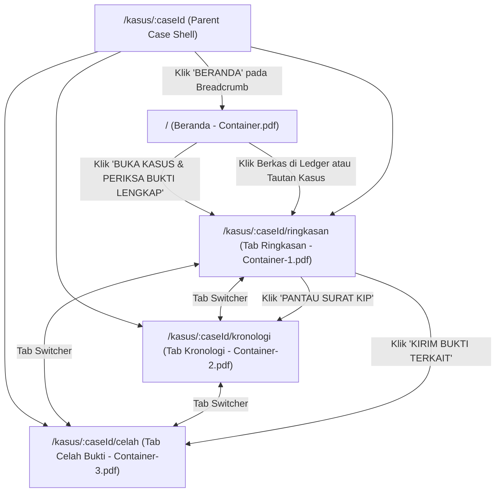
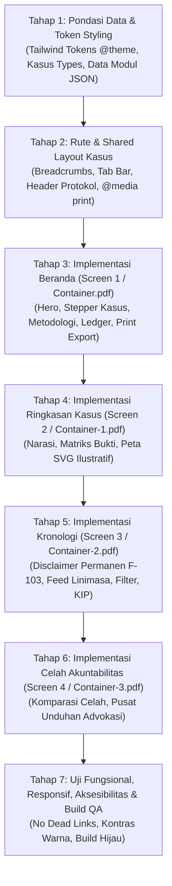

# BINARCELAH — DESIGN-TO-IMPLEMENTATION BLUEPRINT

**Dokumen Kontrol:** Blueprint Arsitektur dan Panduan Implementasi Frontend  
**Status:** Disetujui untuk Panduan Pembangunan First Draft (01 November 2026) — Final Revisi Integritas Bukti BC-04.4.2  
**Sumber Kebenaran Visual:** `Container.pdf`, `Container-1.pdf`, `Container-2.pdf`, `Container-3.pdf`  
**Sumber Kebenaran Ruang Lingkup:** `docs/project-control/` (`00_MASTER_RULES.md` s/d `07_AI_WORK_PROTOCOL.md`)  

---

## 1. APPLICATION ROUTES (ARSITEKTUR RUTE APLIKASI)

Aplikasi dibangun sebagai client-side Single Page Application (SPA) berbasis `react-router-dom`. Mengingat Screen 2, 3, dan 4 merupakan sub-tampilan dari satu dossier kasus investigasi demonstratif yang sama (`#BC-2026-08`), rute disusun secara hierarkis dengan *parent layout* bersama untuk Case Workspace.

### 1.1 Tabel Rute Minimum

| Route Path | Komponen Halaman | Sumber Desain PDF | Deskripsi & Peran |
|---|---|---|---|
| `/` | `HomePage` | `Container.pdf` | **Beranda & Temukan Isu:** Pengenalan platform, metrik target metodologi, kartu sorotan studi kasus demonstratif, metodologi 4-langkah, arsip ledger demonstratif, dan dropzone aman prototipe. |
| `/kasus/:caseId` | `CaseLayout` | *Shared Case Shell* | **Parent Layout Kasus:** Menyediakan header dossier terpadu, breadcrumbs, status investigasi, tab navigasi, dan tombol aksi cetak/simpan PDF laporan. Mengarahkan default ke `/ringkasan`. |
| `/kasus/:caseId/ringkasan` | `CaseOverviewTab` | `Container-1.pdf` | **Tab 1 — Ringkasan & Narasi:** Rekonstruksi alur peristiwa demonstratif, kartu bukti satelit optik ilustratif, matriks triangulasi 3-vektor parameter kasus, ringkasan celah, dan sidebar cakupan spasial ilustratif. |
| `/kasus/:caseId/kronologi` | `CaseChronologyTab` | `Container-2.pdf` | **Tab 2 — Kronologi & Jejak Bukti:** Memuat penafian permanen non-tuduhan pidana terpasang langsung di atas filter linimasa, feed simpul kronologis dengan 4 atribut tanggal parameter, kartu audit pengadaan pompa, dan widget pemantauan KIP demonstratif. |
| `/kasus/:caseId/celah` | `CaseGapsTab` | `Container-3.pdf` | **Tab 3 — Celah Akuntabilitas & Advokasi:** Filter kategori celah, kartu komparasi parameter terdata vs ketertutupan, peta hotspot ilustratif, status data spasial primer belum tersedia, dan langkah permohonan UU KIP dengan pusat unduhan advokasi. |
| `*` | `NotFoundPage` | *System State* | **Halaman 404:** Navigasi kembali ke Beranda jika ID kasus atau rute tidak ditemukan. |

### 1.2 Hubungan Navigasi & Alur Transisi



---

## 2. SHARED LAYOUT & DESIGN SYSTEM (SISTEM DESAIN BERSAMA)

### 2.1 Pondasi Visual & Token Warna (Tailwind CSS v4 `@theme`)

Sesuai `03_DESIGN_AND_UX_RULES.md` dan observasi keempat PDF, token warna dideklarasikan menggunakan blok `@theme` resmi Tailwind CSS v4 di `src/index.css`. Hal ini mengekspos kelas utilitas bawaan Tailwind secara langsung (`text-navy`, `bg-navy`, `bg-ivory`, `border-sapphire`, `text-status-verified-text`, dll.) tanpa membutuhkan konfigurasi runtime terpisah:

```css
/* Konfigurasi @theme Tailwind CSS v4 (untuk diterapkan di src/index.css pada tahap implementasi) */
@import "tailwindcss";

@theme {
  /* Skema Palet Utama BinarCelah */
  --color-navy: #112250;        /* Warna utama teks judul, tombol primer, header */
  --color-sapphire: #3B507D;    /* Sub-heading, border aksen, tag netral, ikon sekunder */
  --color-warm-taupe: #BEB7A7;  /* Garis pemisah lembut, metadata sekunder */
  --color-champagne: #E7E2CE;   /* Aksen latar belakang banner peringatan ringan */
  --color-ivory: #F5F4F0;       /* Kanvas utama latar belakang halaman */
  --color-white: #FFFFFF;       /* Permukaan kartu (card surface) */

  /* Warna Semantik / Status Bukti */
  --color-status-verified-bg: #ECFDF5;
  --color-status-verified-text: #065F46;
  --color-status-verified-border: #A7F3D0;

  --color-status-official-bg: #EFF6FF;
  --color-status-official-text: #1E40AF;
  --color-status-official-border: #BFDBFE;

  --color-status-gap-bg: #FEF2F2;
  --color-status-gap-text: #991B1B;
  --color-status-gap-border: #FECACA;

  --color-status-neutral-bg: #F1F5F9;
  --color-status-neutral-text: #475569;
  --color-status-neutral-border: #CBD5E1;
}
```

*Catatan Kepatuhan:* File `src/index.css` **tidak diedit** pada tugas dokumentasi ini. Penulisan blok `@theme` akan dieksekusi secara nyata pada saat tugas implementasi CSS/styling dimulai.

### 2.2 Aturan Cetak Ekspor PDF (`@media print`)

Sesuai temuan **F-105**, browser print (`window.print()`) difungsikan sebagai aksi **`Cetak / Simpan sebagai PDF`**, bukan unduhan file PDF biner langsung. Pada tahap implementasi styling, wajib disiapkan aturan `@media print` dalam stylesheet:
- **Menyembunyikan:** Elemen navigasi atas, breadcrumb, tab bar kasus, tombol-tombol interaktif, form filter, dan latar belakang gelap yang menghabiskan tinta.
- **Mempertahankan:** Judul kasus, identitas dossier `#BC-2026-08`, feed kronologi faktual, tabel komparasi bukti, dan catatan kaki integritas bukti lengkap dengan tanggal cetak.
- **Header Cetak:** Memuat catatan resmi: *"Laporan Rekonstruksi Bukti BinarCelah — Ekspor Cetak Mandiri (Studi Kasus Demonstratif)"*.

### 2.3 Hirarki Tipografi (Font: Inter)

- **Judul Layar Utama (H1):** `font-bold text-2xl lg:text-3xl text-navy tracking-tight` (misal: "Pahami isu publik melalui bukti.", "Menelusuri Penanganan Kebakaran...").
- **Judul Seksi (H2):** `font-semibold text-lg lg:text-xl text-navy` (misal: "1. Apa yang terjadi?", "Katalog Pembaruan Arsip").
- **Judul Kartu / Subseksi (H3):** `font-semibold text-sm lg:text-base text-navy` (misal: "Deteksi Awal Anomali Termal...").
- **Teks Tubuh (Body):** `text-xs lg:text-sm text-slate-700 leading-relaxed`.
- **Label / Overline / Badge:** `text-[10px] lg:text-xs font-bold uppercase tracking-wider`.
- **Data Kriptografis / Hash / Kode:** `font-mono text-[11px] text-slate-600 bg-slate-100 px-1.5 py-0.5 rounded`.

### 2.4 Kontainer & Grid Tata Letak

- **Lebar Maksimal Kanvas:** `max-w-7xl mx-auto px-4 sm:px-6 lg:px-8` (terpusat, simetris, responsif).
- **Struktur Kartu:** `bg-white rounded-lg border border-slate-200/80 shadow-xs`.
- **Jarak Antar-Seksi:** `space-y-8 lg:space-y-12`.

### 2.5 Header Global & Protokol Bar

Tampil konsisten di bagian paling atas:
- **Bar Protokol:** Latar belakang gelap (`bg-[#0B132B]` atau `bg-navy`), menampilkan:
  - Teks identitas: `TRANSPARANSI PUBLIK BERBASIS BUKTI` dan `REPOSITORI DOKUMEN PUBLIK TERVERIFIKASI`.
  - Protokol audit: `Protokol Audit: ISO 27037 / Standard Forensik Bukti Digital`.
  - Status arsip: Indikator hijau `INTEGRITAS ARSIP PUBLIK: ONLINE` (representasi status perancangan antarmuka visual, diberi tooltip: *"Status perancangan antarmuka repositori"*).
  - Root Hash: Snippet monospace `ROOT: 9cf2a58b...` (tampilan skema arsitektur penandaan hash data).

### 2.6 Case Workspace Shell (`CaseLayout.tsx`)

Membungkus Screen 2, 3, dan 4:
1. **Breadcrumbs:** `BERANDA / TEMUKAN ISU / DOSSIER BC-2026-08 / [SUB-HALAMAN]`
2. **Metadata Header Kasus:**
   - Baris 1: ID `#BC-2026-08`, Wilayah `Kalimantan Tengah / Koridor Penyangga Sekonyer`, Tanggal Pemeriksaan Terakhir: `Oktober 2026`.
   - Baris 2: Judul Kasus Utama dan Paragraf Ruang Lingkup Penyelidikan.
   - Baris 3: Status Badge (`PENELITIAN SEDANG BERJALAN`), Skor Spekulasi (diberi label jelas: `TARGET METODOLOGI — BUKAN STATUS VERIFIKASI DATA SAAT INI`), Root Hash Kasus.
3. **Tab Navigasi Horizontal:**
   - Tab 1: `RINGKASAN & NARASI` (rute: `/kasus/:caseId/ringkasan`)
   - Tab 2: `KRONOLOGI & JEJAK BUKTI` (rute: `/kasus/:caseId/kronologi`)
   - Tab 3: `CELAH AKUNTABILITAS & LANGKAH LANJUTAN` (rute: `/kasus/:caseId/celah`) dengan badge merah `3 AKTIF`.
   - Tombol Aksi Kanan: `EKSPOR KASUS (PDF)` (memicu `window.print()` dengan label aksi *Cetak / Simpan sebagai PDF*) dan `JSON SUMBER / MANIFEST`.

---

## 3. SCREEN IMPLEMENTATION SPECIFICATIONS (SPESIFIKASI TIAP LAYAR)

### 3.1 Screen 1: Home / Issue Discovery (`Container.pdf`)

- **Tujuan Halaman:** Memperkenalkan proposisi nilai BinarCelah, mengedukasi warga tentang metode pembuktian, menyorot kasus utama demonstratif, dan menyajikan katalog arsip.
- **Urutan Seksi:**
  1. *Top Bar Protokol Forensik:* Header sistem kriptografis.
  2. *Hero Section:*
     - Headline besar: "Pahami isu publik melalui bukti."
     - Paragraf ringkas: Eksplorasi fakta terdokumentasi tanpa interpretasi spekulatif.
     - Tombol CTA: `TELUSURI ISU PUBLIK →` (scroll halus ke kartu kasus) & `PROTOKOL VERIFIKASI MANDIRI` (scroll ke seksi metodologi).
     - Panel kanan: Penjelasan integritas arsip publik dan sidik jari SHA-256.
  3. *Key Metric Strip (4 Kolom Sesuai F-PROV-04):*
     - `28 DOSSIER AKTIF` (Proyeksi Target)
     - `1.420 DOKUMEN PRIMER TERINDEKS` (Proyeksi Target)
     - `TARGET METODOLOGI — BELUM MERUPAKAN HASIL AUDIT DATA` (Menggantikan klaim 0% skor spekulatif aktual)
     - `CHECKSUM SHA-256` (Arsitektur Pengujian Integritas Payload)
  4. *Featured Case Spotlight Card (`Dossier Khusus Investigasi Aktif`):*
     - Header kasus: `#BC-2026-08`, status, wilayah.
     - Judul: "Menelusuri penanganan kebakaran Taman Nasional Tanjung Puting".
     - Narasi komparasi satelit, SK tanggap darurat, DIPA Rp 14,2 Miliar, dan realisasi lapangan.
     - Panel kanan: Audit alur 75% selesai (3 dari 4 rantai terpetakan).
     - *Chain of Evidence Stepper (4 Simpul Horizontal Sesuai F-PROV-04):*
       - Simpul 01: Peristiwa — Terdeduksi Satelit `[PARAMETER STUDI KASUS]`
       - Simpul 02: Respon Pemerintah — SK Gakkum No. 441 `[PARAMETER STUDI KASUS]`
       - Simpul 03: Alokasi Anggaran — DIPA Rp 14,2 Miliar `[PARAMETER STUDI KASUS]`
       - Simpul 04: Kesenjangan Data — Pengadaan Pompa & BAST `[CELAH BUKTI]`
     - Footer aksi: Tombol `BUKA KASUS & PERIKSA BUKTI LENGKAP` (navigasi ke `/kasus/BC-2026-08/ringkasan`) & `UNDUH DOSSIER (PDF)` (memicu dialog cetak/simpan PDF peramban dengan format laporan bersih).
  5. *Metodologi 4-Langkah (`Prosedur Ilmiah Jurnalisme Bukti`):*
     - Grid 4 kolom: `01 / Pahami`, `02 / Telusuri`, `03 / Temukan Kesenjangan`, `04 / Tindak Lanjut`.
  6. *Live Forensic Ledger (`Katalog Pembaruan Arsip Terakhir` Sesuai F-PROV-04):*
     - Tabel daftar entri arsip perancangan demonstratif lengkap dengan status yang jujur:
       - `DOC-KLHK-2026-092`: Status `[BELUM TERVERIFIKASI PRIMER]`
       - `DOC-KEMENKEU-DIPA-88`: Status `[BELUM TERVERIFIKASI PRIMER]`
       - `DOC-LPSE-KTG-2026-X`: Status `[DOKUMEN TIDAK TERSEDIA DALAM REPOSITORI]`
     - Tombol aksi `Periksa` membuka modal inspeksi parameter demonstratif, tombol `Ajukan KIP` navigasi ke panduan advokasi.
  7. *Encrypted Secure Drop Box:*
     - Panel dropzone anonim prototipe, fingerprint PGP, 3 pilar keamanan (pembersihan metadata, tanpa log IP, mandat pers), dan disclaimer hukum.
- **Adaptasi Responsif:**
  - *Mobile (<768px):* Stepper 4 langkah berubah menjadi daftar bertumpuk (stacked vertical list). Metric strip menjadi grid 2x2. Tabel ledger dapat di-scroll horizontal secara halus. Form upload tetap responsif full-width.

---

### 3.2 Screen 2: Case Workspace — Overview (`Container-1.pdf`)

- **Tujuan Halaman:** Menyajikan investigasi terinci kasus Tanjung Puting melalui rekonstruksi faktual, matriks triangulasi multi-vektor, dan ekspos celah akuntabilitas.
- **Tata Letak Utama:** 2 Kolom Asimetris (Kiri ~65% Konten Narasi & Bukti, Kanan ~35% Sidebar Analisis & Dropzone Kasus).
- **Konten Kolom Kiri:**
  1. *Seksi 1: "1. Apa yang terjadi?" (Rekonstruksi Faktual):*
     - Narasi deteksi anomali termal 12–18 Oktober 2026. Membedakan secara akurat antara sensor radiometri termal (VIIRS / MODIS) dan sensor optik multispektral (Sentinel-2 L2A).
     - Kartu Bukti Dokumen `#01-A` (Citra Satelit Sentinel-2 L2A, koordinat, hash, tombol viewer).
     - Narasi respon SK Ditjen Gakkum No. 441/2026 dan disparitas waktu mobilisasi.
     - Widget *Chain of Timestamps* (3 simpul: Deteksi Awal, Penerbitan SK, Mobilisasi Pompa).
  2. *Seksi 2: "2. Apa yang ditunjukkan bukti?" (Matriks Triangulasi Parameter Sesuai F-PROV-04):*
     - Penjelasan prinsip triangulasi data negara vs satelit.
     - Tabel Matriks Multi-Sumber (3 baris vektor berlabel jujur):
       - Vektor A: Titik Panas & Deteksi Ruang (NASA FIRMS / LAPAN BRIN) `[PARAMETER STUDI KASUS]`
       - Vektor B: Respon Komando Wilayah (Ditjen Gakkum KLHK) `[PARAMETER STUDI KASUS]`
       - Vektor C: Alokasi Finansial & Logistik (DIPA Kemenkeu BA 029) `[PARAMETER STUDI KASUS]`
     - Footer status penandaan data Merkle Tree `#BK-9021-ID` (diberi catatan: *"Skema visual penandaan integritas audit data"*).
  3. *Seksi 3: "3. Apa yang belum jelas? (Celah Bukti)":*
     - Disclaimer etika bukti sipil (asas praduga tak bersalah, merujuk hak UU KIP).
     - 3 Kartu Celah Akuntabilitas:
       - Celah #01: Ketiadaan Kontrak & BAST 12 Pompa Khusus Gambut (DIPA Rp 4,8 M) -> Tombol `PANTAU SURAT KIP →`.
       - Celah #02: Ketiadaan Laporan Asesmen Dampak Paparan Asap terhadap Orangutan Camp Leakey -> Tombol `KIRIM BUKTI TERKAIT`.
       - Celah #03: Status Parit Drainase Gambut di Perbatasan Konsesi HGU Sawit -> Tautan Sengketa Informasi KIP.
- **Konten Kolom Kanan (Sidebar):**
  1. *Cakupan Spasial Investigasi (Visual Asset Sesuai F-104 & F-PROV-01):*
     - Menampilkan grafis peta ilustratif berbasis SVG/vektor teranotasi yang menggambarkan batas koridor DAS Sekonyer dan zona penyangga, bukan live GIS rasters atau poligon koordinat yang diklaim sebagai data terukur.
     - Diberi label transparan: `[PETA ILUSTRATIF STUDI KASUS — BUKAN CITRA GEOSPASIAL RESMI]`.
     - Parameter: Koordinat teks `2°45'S 111°58'E`, luas indikasi `±480 Ha`, ekosistem gambut dalam (>3m).
  2. *Statistik Integritas Dossier:* Grid metrik mini (12 Dokumen Terdaftar pada Studi Kasus, 04 Parameter Silang, 03 Celah Terbuka, Progress Ring 75% Penutupan Rantai berdasarkan rasio 3 dari 4 rantai terpetakan).
  3. *Rantai Bukti Kasus (Chain of Custody):* 4 item checklist status (3 Lengkap dalam skenario, 1 Celah Bukti).
  4. *Secure Drop Spesifik Kasus #BC-2026-08:* Dropzone berkas bukti lapangan, kunci PGP kasus (prototipe non-operasional).
  5. *Metadata Dossier Publik:* Inisiator (Divisi Forensik Hutan Binar Celah), Reviewer (2 Editor Independen), Lisensi (CC BY-SA 4.0), URN.
- **Adaptasi Responsif:**
  - *Mobile / Tablet (<1024px):* Kolom kanan sidebar berpindah posisi ke bawah kolom narasi (single-column layout).

---

### 3.3 Screen 3: Case Workspace — Chronology & Traceability (`Container-2.pdf`)

- **Tujuan Halaman:** Menyajikan rekonstruksi berurutan secara temporal untuk mengidentifikasi celah waktu birokrasi, disparitas administrasi, dan keterlambatan logistik.
- **Mandat Disclaimer Kontekstual Permanen (Sesuai F-103):**
  Tepat di bawah judul halaman dan di atas bar kontrol filter, wajib terpasang kotak penafian permanen yang terlihat langsung tanpa membuka modal, dengan teks persis:
  > **"Kronologi ini merupakan rekonstruksi alur kerja metodologis BinarCelah untuk menguji ketersediaan data terbuka. Jeda waktu dan catatan disparitas disusun berdasarkan parameter studi kasus demonstratif dan bukan merupakan tuduhan kesengajaan atau vonis pelanggaran hukum."**
- **Klasifikasi Interval Waktu (Sesuai F-103):**
  Catatan disparitas waktu (misal: "jeda administratif 78 jam 46 menit") diklasifikasikan secara tegas sebagai **kalkulasi demonstratif berbasis stempel waktu mockup**, bukan keterlambatan administratif yang terotentikasi, dan tidak boleh dinarasikan sebagai bukti kelalaian pidana.
- **Urutan Seksi:**
  1. *Kotak Penafian Kontekstual Permanen:* Teks mandat F-103 dengan latar belakang `bg-amber-50 border border-amber-200 text-amber-900 rounded-md p-3.5 text-xs lg:text-sm`.
  2. *Bar Kontrol Filter Linimasa:*
     - Dropdown `Status Bukti` (Semua Status Parameter)
     - Dropdown `Jenis Peristiwa` (Semua Jenis Peristiwa)
     - Date Range Picker `Rentang Tanggal` (01 Okt 2026 – 31 Okt 2026)
     - Dropdown `Wilayah / Sektor` (Koridor Sekonyer)
     - Tombol `Reset Filter`
     - View Mode Switcher: `Dual Split` (Nonaktif/Segera Hadir) | `Kronologi` (Aktif) | `Graph Mode` (Nonaktif/Segera Hadir)
  3. *Protokol Integritas Tanggal Binar Celah (Legenda 4 Atribut):*
     - `[TGL PERISTIWA]`: Kejadian fisik pada skenario.
     - `[TGL DOKUMEN]`: Penerbitan surat/arsip dalam skenario.
     - `[TGL PUBLIKASI]`: Ketersediaan di domain publik.
     - `[STEMPEL VERIFIKASI]`: Validasi hash payload lokal.
  4. *Feed Linimasa Kronologis Berurutan (Status Sesuai F-PROV-04):*
     Setiap simpul terdiri dari kolom tanggal & waktu di sebelah kiri, garis vertikal penghubung (connector line), dan kartu konten terperinci di sebelah kanan:
     - **Simpul #01 (12 Okt 2026, 03:14 WIB):** Deteksi Anomali Termal Satelit MODIS & Sentinel-2A. (Status: `[PARAMETER STUDI KASUS]`, Aksi: `BUKA RAW DATA SATELIT`, `METADATA`).
     - **Simpul #02 (14 Okt 2026, 16:45 WIB):** Laporan Lapangan Titik Api Terpantau Menjalar pada Gambut Dalam (MPA Teluk Pulai). (Status: `[PARAMETER STUDI KASUS]`, Aksi: `LIHAT TRANSKRIP LAPORAN`, `VERIFIKASI HASH`).
     - **Simpul #03 (15 Okt 2026, 14:00 WIB):** Surat Keputusan Tanggap Darurat Ditjen Gakkum No. 441/2026. (Status: `[PARAMETER STUDI KASUS]`, File: 2.4 MB pada mockup, Aksi: `UNDUH SALINAN SK` [Membuka Modal Status Dokumen Belum Tersedia sesuai F-PROV-02], `UJI VALIDITAS TTE`).
     - **Simpul #04 (20 Okt 2026, 09:15 WIB):** Pencatatan DIPA Petikan Rp 14,2 Miliar pada Bagian Anggaran 029 (SPAN Kemenkeu). (Status: `[PARAMETER STUDI KASUS]`, Aksi: `PERIKSA ARSIP SPAN`, `CEK KODE TRANSAKSI`).
  5. *Spanduk Peringatan Kritis (Crimson Banner):*
     "HUBUNGAN ANGGARAN BELUM TERBUKTI / CELAH BUKTI KRITIS: Realisasi fisik logistik tidak dapat diverifikasi silang dengan kontrak pengadaan terbuka maupun berita acara serah terima di lapangan."
  6. *Kartu Audit Triangulasi Celah Bukti #01:*
     - Judul: "Anomali Pengadaan 12 Pompa Khusus Gambut (DIPA Rp 4,8 Miliar)".
     - 3 Kolom Komparasi: Parameter DIPA Kemenkeu vs Rekam LPSE Absen vs Laporan Defisit Armada Lapangan.
  7. *Widget Pemantauan Permohonan Informasi Publik (PPID):*
     - Nomor Tiket `#KIP-2026-X889` (Simulasi Hari ke-6 dari 10 Hari Kerja UU No. 14/2008).
     - Indikator progres horizontal.
     - Tombol Aksi: `PANTAU STATUS PPID`, `DRAF SURAT KEBERATAN`, `KIRIM BUKTI ANONIM`.
  8. *Footer Integritas Bukti & Checksum Payload:*
     - Pernyataan asas praduga tak bersalah dan hash integritas payload data kasus.
- **Adaptasi Responsif:**
  - *Mobile (<768px):* Kolom stempel waktu berpindah ke atas kartu masing-masing simpul. Garis konektor timeline tetap terlihat di sisi kiri. 3 kolom audit triangulasi pompa berubah menjadi kartu stacked vertikal.

---

### 3.4 Screen 4: Case Workspace — Accountability Gaps & Advocacy (`Container-3.pdf`)

- **Tujuan Halaman:** Menganalisis secara mendalam 3 celah transparansi utama, menyajikan pertanyaan riset terstruktur, memetakan data spasial, dan memfasilitasi advokasi permohonan informasi publik (UU KIP No. 14/2008).
- **Urutan Seksi:**
  1. *Sub-Header & Aksi:*
     - Breadcrumb, Judul Kasus & Sub-Judul: "Komparasi forensik alokasi kedaruratan, logistik teknis, dan data ekologis".
     - Tombol Header: `SALIN MANIFEST HASH` dan `UNDUH BERKAS ADVOKASI (ZIP)` (membuka Modal Pusat Unduhan Advokasi).
  2. *Summary KPI Strip (4 Blok Metrik Sesuai F-PROV-04):*
     - `3 Celah AKUNTABILITAS TERIDENTIFIKASI`
     - `8 Dokumen [PARAMETER STUDI KASUS]` (Bukan klaim dokumen terverifikasi faktual)
     - `Hari ke-6 1 PERMOHONAN PPID BERJALAN` (Simulasi Alur Kerja)
     - `100% Bebas TUDUHAN PIDANA (AUDIT HAK PUBLIK)`
  3. *Kategori Filter Celah (Pills Switcher):*
     - `SEMUA (3)` (Aktif)
     - `DOKUMEN REALISASI (1)`
     - `ANGGARAN (1)`
     - `DAMPAK EKOLOGIS (1)`
  4. *Daftar Kartu Pertanyaan Riset & Komparasi Celah (3 Kartu Terperinci):*
     - **Kartu Celah #01 (`#CELAH-2026-01` — TINGGI):** Logistik Pengadaan Pompa. Komparasi parameter DIPA Rp 4,8 M vs Ketiadaan Arsip LPSE.
     - **Kartu Celah #02 (`#CELAH-2026-02` — SEDANG Sesuai F-PROV-04):** Alokasi Biaya Sewa Heli Water Bombing. Diberi klasifikasi: `[KLAIM BELUM TERKONFIRMASI — PARAMETER STUDI KASUS]`. Menghapus klaim "Fakta Empiris Diketahui", menarasikannya secara objektif sebagai perbandingan antara klaim pengeluaran sewa heli Kamov Ka-32 Rp 9,4 Miliar terhadap ketiadaan flight manifest terbuka.
     - **Kartu Celah #03 (`#CELAH-2026-03` — TINGGI):** Dampak Konsentrasi Asap terhadap Orangutan Camp Leakey.
     - Tombol Aksi tiap kartu: `LIHAT BUKTI TERKAIT (3 DOKUMEN)`, `DRAF PERTANYAAN INFORMASI (UU KIP)`, `SALIN KUTIPAN FAKTUAL`.
  5. *Seksi Spasial & Hotspot (Visual Asset Sesuai F-104 & F-PROV-01):*
     - Visual kartu peta anomali termal berbasis SVG ilustratif yang menampilkan indikasi zonasi sebaran titik panas di koridor Sekonyer (1.420 Ha).
     - Diberi keterangan jelas: `[PETA ILUSTRATIF STUDI KASUS — BUKAN BUKTI GEOSPASIAL RESMI]`.
  6. *Seksi Pedoman Advokasi Berbasis Bukti (3 Langkah Warga Sesuai F-PROV-01, 02, 03):*
     - `01 / VALIDASI PRIMER` (Inspeksi Dokumen Asli):
       - `UNDUH DATA SPASIAL (.GEOJSON)` -> **Digantikan Status Data Belum Tersedia (F-PROV-01):** Membuka modal status: `DATA SPASIAL PRIMER BELUM TERSEDIA`. Menerangkan bahwa geometri batas dan telemetri primer belum dibuka ke publik, menolak fabrikasi poligon buatan.
       - `UNDUH PETIKAN DIPA (.PDF)` -> **Digantikan Modal Catatan Alokasi Anggaran (F-PROV-03):** Membuka modal `Catatan Alokasi Anggaran — Parameter Studi Kasus Demonstratif` yang memaparkan catatan anggaran tanpa menghasilkan file PDF resmi palsu.
       - `CEK MERKLE ROOT SHA-256` -> Membuka modal inspeksi integritas payload lokal.
     - `02 / FORMULASI SURAT` (Susun Pertanyaan KIP):
       - `DRAF FORMAT PPID KLHK (.DOCX)` -> Mengunduh template formulir teks resmi `Formulir_Permohonan_Informasi_KLHK.txt` dan menyediakan modal salin draf terformat.
       - `DRAF FORMAT KEMENKEU (.TXT)` -> Mengunduh `Formulir_Permohonan_Informasi_Kemenkeu.txt`.
       - `LIHAT PANDUAN HAK WARGA` -> Membuka modal edukasi hak warga negara atas keterbukaan informasi publik.
     - `03 / PENGIRIMAN RESMI` (Saluran Pemerintah): Tautan eksternal ke PPID KLHK, PPID Kemenkeu, dan Portal SP4N-LAPOR!.
  7. *Spanduk Perlindungan Hak Privasi & Non-Afiliasi:*
     - Penegasan independensi platform jurnalisme dan penolakan representasi kuasa hukum.
- **Adaptasi Responsif:**
  - *Mobile (<768px):* Grid 2 kolom komparasi disusun bertumpuk vertikal (Parameter Terdata diikuti Kesenjangan Data).

---

## 4. COMPONENT INVENTORY & REUSE MAP (INVENTARISASI KOMPONEN)

Komponen disusun untuk mendukung keandalan kode tanpa menambah abstraksi berlebih:

### 4.1 Komponen Bersama (Shared Components)
1. `ProtocolHeader`: Bilah atas gelap berisi protokol ISO 27037 dan status integritas sistem.
2. `StatusBadge`: Badge semantik dengan varian status (`verified`, `official`, `gap`, `neutral`, `case_param`, `repo_unavailable`).
3. `CryptoHashSnippet`: Tampilan teks monospace untuk hash SHA-256 terpotong dengan tombol salin (copy-to-clipboard) visual.
4. `EthicalDisclaimer`: Komponen kotak pengingat etika bukti sipil dan asas praduga tak bersalah.
5. `CaseLayout`: Template pembungkus layar dossier kasus (Screen 2, 3, dan 4) dengan breadcrumb dan tab bar navigasi.
6. `BaseInspectionModal`: Komponen modal dasar yang memuat penafian baku:  
   `STUDI KASUS DEMONSTRATIF — PARAMETER BELUM TERVERIFIKASI PRIMER`  
   serta tombol tutup (`X` / `Tutup`).

### 4.2 Komponen Khusus Beranda (Home-Specific)
1. `HeroSection`: Blok pesan utama dan pengantar platform.
2. `MetricCounterStrip`: 4 kartu metrik target metodologi di bawah hero.
3. `FeaturedCaseCard`: Kartu sorotan kasus investigasi Tanjung Puting dengan horizontal chain stepper berlabel parameter studi kasus.
4. `MethodologyGrid`: 4 kartu langkah cara kerja platform.
5. `ForensicLedgerTable`: Tabel pembaruan arsip dokumen demonstratif.
6. `SecureDropZone`: Area dropzone unggah anonim prototipe dengan penjelasan transparan.

### 4.3 Komponen Khusus Case Overview (Screen 2)
1. `EvidenceCardSatellite`: Kartu bukti dokumen citra satelit #01-A dengan visual SVG ilustratif.
2. `TriangulationTable`: Tabel matriks triangulasi multi-vektor parameter kasus.
3. `SpatialCoverageCard`: Panel peta SVG ilustratif koridor Sekonyer beserta parameter batas wilayah.
4. `DossierIntegrityWidget`: Widget metrik lingkaran persentase penyelesaian rantai bukti (75%).
5. `ChainOfCustodyChecklist`: Daftar status 4 tahapan verifikasi bukti skenario.

### 4.4 Komponen Khusus Kronologi (Screen 3)
1. `ChronologyMandatoryDisclaimer`: Kotak penafian kontekstual permanen non-tuduhan pidana (F-103).
2. `TimelineFilterBar`: Kumpulan filter status, jenis peristiwa, rentang tanggal, dan pengalih tampilan.
3. `TimelineDateProtocol`: Panduan visual 4 stempel tanggal integritas.
4. `TimelineNodeItem`: Simpul linimasa individual (kolom tanggal + kartu konten + konektor vertikal).
5. `CriticalGapBanner`: Spanduk crimson penanda celah kritis hubungan anggaran-lapangan.
6. `PumpProcurementAuditCard`: Kartu komparasi 3 pilar audit pompa darurat (DIPA vs LPSE vs Fakta Lapangan).
7. `PpidCountdownWidget`: Bilah progres batas waktu 10 hari kerja permohonan UU KIP demonstratif.

### 4.5 Komponen Khusus Celah Akuntabilitas & Advokasi (Screen 4)
1. `GapCategoryFilter`: Filter pills untuk menyaring celah berdasarkan topik (Realisasi, Anggaran, Ekologi).
2. `GapComparisonCard`: Kartu pertanyaan riset dengan layout komparasi dua kolom (Parameter Terdata vs Kesenjangan Data).
3. `HotspotSpatialCard`: Kartu visualisasi peta SVG anomali suhu berlabel ilustratif.
4. `AdvocacyStepsGrid`: 3 kartu langkah advokasi warga dengan tombol unduh berkas template dan tautan portal resmi.
5. `AdvocacyDownloadCenterModal`: Modal pusat unduhan paket advokasi perorangan yang menyajikan template teks resmi.

---

## 5. INTERACTION SPECIFICATIONS & INTEGRITY RULES (REGISTRI INTERAKSI FINAL)

Sesuai `00_MASTER_RULES.md` dan temuan **F-PROV-01 s/d F-PROV-04**:
- Seluruh modal menampilkan penafian wajib:  
  `STUDI KASUS DEMONSTRATIF — PARAMETER BELUM TERVERIFIKASI PRIMER`
- Setiap berkas teks yang diunduh wajib memuat teks catatan integritas:  
  `[CATATAN INTEGRITAS: Dokumen ini adalah bagian dari studi kasus demonstratif BinarCelah untuk evaluasi First Draft dan BUKAN dokumen resmi yang diterbitkan instansi pemerintah.]`

| Elemen UI / Tombol | Lokasi Layar | Klasifikasi Interaksi | Perilaku & Hasil Nyata pada First Draft |
|---|---|---|---|
| **`TELUSURI ISU PUBLIK →`** | Screen 1 (Hero) | Fungsional Penuh | Melakukan smooth-scroll langsung ke elemen kartu `Dossier Khusus Investigasi Aktif`. |
| **`PROTOKOL VERIFIKASI MANDIRI`** | Screen 1 (Hero) | Fungsional Penuh | Melakukan smooth-scroll langsung ke Seksi `Metodologi & Cara Kerja Platform` (Seksi 4 Langkah). |
| **`BUKA KASUS & PERIKSA BUKTI LENGKAP`** | Screen 1 (Featured Card) | Fungsional Penuh | Navigasi via React Router ke rute `/kasus/BC-2026-08/ringkasan`. |
| **`UNDUH DOSSIER (PDF)`** | Screen 1 (Featured Card) & Screen 2 (Header) | Fungsional Penuh (Cetak / Simpan PDF) | Menjalankan dialog cetak browser (`window.print()`) yang didukung aturan `@media print` untuk mencetak atau menyimpan laporan dossier sebagai PDF bersih tanpa elemen navigasi. |
| **`EKSPOR KASUS (PDF)`** | Screen 2 (Header) | Fungsional Penuh (Cetak / Simpan PDF) | Menjalankan `window.print()` untuk mengekspor halaman dossier yang sedang aktif sebagai PDF laporan bersih. |
| **`JSON SUMBER` / `JSON MANIFEST`** | Screen 2 & Screen 3 (Header) | Fungsional Penuh (Unduhan JSON) | Mengunduh file manifest `dossier-bc-2026-08.json` nyata yang di-generate langsung dari modul data lokal `data/cases.ts` dengan properti `_disclaimer` dan status parameter yang jujur. |
| **Tab Navigasi Kasus (`Ringkasan`, `Kronologi`, `Celah`)** | Screen 2, 3, 4 (Sub-Header) | Fungsional Penuh | Berpindah antar sub-rute kasus (`/ringkasan`, `/kronologi`, `/celah`) secara instan via React Router tanpa memicu page reload. |
| **Breadcrumb `BERANDA` & `TEMUKAN ISU`** | Screen 2, 3, 4 (Top Header) | Fungsional Penuh | Navigasi kembali ke Beranda (`/`). |
| **Tombol `Periksa` pada Baris Ledger** | Screen 1 (Ledger Table) | Modal Rekonstruksi Bukti Kasus | Membuka modal inspeksi metadata dokumen ledger demonstratif dengan header penafian studi kasus. |
| **Tombol `Ajukan KIP` pada Baris Ledger** | Screen 1 (Ledger Table) | Fungsional Penuh | Navigasi ke rute `/kasus/BC-2026-08/celah` langsung pada seksi panduan permohonan UU KIP. |
| **`Buka Viewer Citra Satelit` / `BUKA RAW DATA SATELIT`** | Screen 2 (Bukti #01-A) & Screen 3 (Simpul #01) | Modal Data Studi Kasus (Konteks Demonstratif) | Membuka modal pratinjau grafis vektor satelit optik ilustratif dengan koordinat 2°45'S 111°58'E, mencantumkan penafian visual dan parameter sensor multispektral Sentinel-2 L2A (bukan termal). |
| **`METADATA`** | Screen 3 (Simpul #01) | Modal Data Studi Kasus (Konteks Demonstratif) | Membuka modal parameter teknis satelit (L2A, orbit Suomi NPP, VIIRS/MODIS) dengan label parameter demonstratif. |
| **`LIHAT TRANSKRIP LAPORAN`** | Screen 3 (Simpul #02) | Modal Data Studi Kasus (Konteks Demonstratif) | Membuka modal teks transkrip logbook catatan situasi harian Posko Masyarakat Peduli Api (MPA) Teluk Pulai berlabel rekaman demonstratif. |
| **`VERIFIKASI HASH` / `CEK MERKLE ROOT SHA-256`** | Screen 3 (Simpul #02) & Screen 4 (Advokasi) | Modal Integritas Payload Lokal | Membuka modal inspeksi yang menampilkan nilai hash SHA-256 statis dan menghitung checksum payload lokal via Web Crypto API, memuat penafian: *"Kalkulasi hash lokal ini hanya memverifikasi keutuhan payload statis aplikasi, bukan pembuktian keaslian hukum arsip negara atau sertifikat digital BSrE."* |
| **`UNDUH SALINAN SK`** | Screen 3 (Simpul #03) | Modal Status Dokumen Belum Tersedia | Sesuai temuan F-PROV-02: Tidak menyediakan unduhan file bertajuk `SK_GAKKUM_KLHK_No_441_2026_Ringkasan.txt`. Tombol membuka modal bertajuk `STATUS DOKUMEN: BELUM TERSEDIA DALAM REPOSITORI`. Modal menerangkan bahwa dokumen fisik SK No. 441/2026 belum tersedia di repositori publik dan ketiadaan dokumen ini merupakan bagian dari pengujian alur permohonan informasi PPID. Meniadakan unduhan file palsu pada First Draft. |
| **`UJI VALIDITAS TTE`** | Screen 3 (Simpul #03) | Modal Data Studi Kasus (Konteks Demonstratif) | Membuka modal penjelasan teknis verifikasi TTE Balai Sertifikasi Elektronik (BSrE) pada studi kasus, dilengkapi penafian tegas: *"Tanda tangan elektronik ini belum divalidasi ke server otoritas sertifikasi BSrE dan disajikan sebagai demonstrasi parameter tata letak."* |
| **`PERIKSA ARSIP SPAN`** | Screen 3 (Simpul #04) | Modal Data Studi Kasus (Konteks Demonstratif) | Membuka modal ringkasan pembukuan perbendaharaan negara SPAN BA 029 berlabel demonstratif. |
| **`CEK KODE TRANSAKSI`** | Screen 3 (Simpul #04) | Modal Data Studi Kasus (Konteks Demonstratif) | Menampilkan rincian Satker `521890`, Akun `537112` dalam konteks demonstrasi pencatatan anggaran tanpa mengklaim keaslian transaksi perbankan. |
| **Filter Linimasa (`Status Bukti`, `Jenis Peristiwa`, `Tanggal`, `Sektor`)** | Screen 3 (Filter Bar) | Fungsional Penuh | Menyaring daftar simpul linimasa secara reaktif berbasis local state React. Menampilkan empty state jika kombinasi filter tidak memiliki data. |
| **`Reset Filter`** | Screen 3 (Filter Bar) | Fungsional Penuh | Mengembalikan seluruh filter linimasa ke status default (menampilkan seluruh 4 simpul terindeks). |
| **Pengalih Tampilan (`Dual Split`, `Graph Mode`)** | Screen 3 (Filter Bar) | Ditunda (Deferred) | Tombol berstatus nonaktif (`disabled`) dengan penanda visual *"Segera Hadir pada Tahap Lanjutan"*, mempertahankan mode `Kronologi` sebagai alur utama yang bekerja. |
| **`PANTAU SURAT KIP →`** | Screen 2 (Celah #01) | Fungsional Penuh | Navigasi langsung ke rute `/kasus/BC-2026-08/kronologi` dan melakukan smooth-scroll ke posisi widget pelacak PPID. |
| **`PANTAU STATUS PPID`** | Screen 3 (Widget PPID) | Modal Data Studi Kasus (Konteks Demonstratif) | Membuka modal rincian tahapan permohonan keterbukaan informasi (UU No. 14/2008), menjelaskan simulasi penantian hari kerja ke-6 dari tenggat 10 hari kerja. |
| **`DRAF SURAT KEBERATAN`** | Screen 3 (Widget PPID) | Fungsional Penuh (Unduhan Teks & Salin) | Mengunduh file template teks `Draf_Surat_Keberatan_PPID.txt` yang memuat catatan integritas wajib, serta membuka modal salin template surat. |
| **`KIRIM BUKTI ANONIM` / `KIRIM BUKTI TERKAIT`** | Screen 3 (Widget PPID) & Screen 2 (Celah #02) | Fungsional Penuh | Navigasi/scroll langsung ke panel `Kanal Pengiriman Terenkripsi / Secure Drop`. |
| **`SALIN KUTIPAN FAKTUAL`** | Screen 4 (Kartu Celah #01, #02, #03) | Fungsional Penuh | Menyalin teks rumusan komparasi parameter kasus vs kesenjangan data ke clipboard pengguna, memicu notifikasi visual "Kutipan Tersalin". |
| **`LIHAT BUKTI TERKAIT (3 DOKUMEN)`** | Screen 4 (Kartu Celah) | Modal Data Studi Kasus (Konteks Demonstratif) | Membuka modal ringkasan 3 rujukan parameter studi kasus yang mendasari perumusan celah informasi. |
| **`DRAF PERTANYAAN INFORMASI (UU KIP)`** | Screen 4 (Kartu Celah) | Modal Data Studi Kasus (Konteks Demonstratif) | Membuka modal teks siap-salin berisi draf formal pengajuan permohonan informasi publik sesuai pasal UU KIP. |
| **Filter Pills Celah (`SEMUA`, `REALISASI`, `ANGGARAN`, `EKOLOGIS`)** | Screen 4 (Filter Bar) | Fungsional Penuh | Menyaring daftar kartu kesenjangan informasi secara reaktif sesuai kategori yang dipilih. |
| **`SALIN MANIFEST HASH` / Tombol Salin Monospace** | Semua Layar | Fungsional Penuh | Menyalin nilai hash SHA-256 terkait ke clipboard pengguna dengan indikator visual *"Tersalin"*. |
| **`UNDUH BERKAS ADVOKASI (ZIP)`** | Screen 4 (Header) | Modal Pusat Unduhan Advokasi | Sesuai temuan F-101: Membuka **Modal Pusat Unduhan Advokasi (Advocacy Download Center)** yang memungkinkan warga mengunduh berkas teks template perorangan (`.txt`) atau menyalin teks secara terpisah. Modal secara jujur menjelaskan bahwa file arsip ZIP gabungan tidak di-generate client-side untuk menghindari dependensi liar. |
| **`UNDUH DATA SPASIAL (.GEOJSON)`** | Screen 4 (Langkah 01) | Status Data Belum Tersedia / Modal Informatif | Sesuai temuan F-PROV-01: Tidak menyediakan unduhan file `.geojson` dengan koordinat rekaan. Tombol membuka modal status bertajuk `DATA SPASIAL PRIMER BELUM TERSEDIA`. Modal menjelaskan bahwa data batas spasial resmi dan telemetri satelit primer koridor Sekonyer belum dirilis oleh otoritas berwenang ke dalam repositori terbuka, dan menyarankan permohonan informasi via saluran PPID. Menolak fabrikasi poligon GIS buatan. |
| **`UNDUH PETIKAN DIPA (.PDF)`** | Screen 4 (Langkah 01) | Modal Catatan Alokasi Anggaran | Sesuai temuan F-PROV-03: Membuka modal bertajuk `Catatan Alokasi Anggaran — Parameter Studi Kasus Demonstratif` yang memaparkan ringkasan pencatatan alokasi anggaran studi kasus tanpa menjanjikan unduhan PDF DIPA resmi atau mencetak dokumen seolah-olah surat resmi negara. |
| **`DRAF FORMAT PPID KLHK (.DOCX)`** | Screen 4 (Langkah 02) | Fungsional Penuh (Unduhan Teks & Salin) | Sesuai temuan F-101: Mengunduh template formulir teks resmi `Formulir_Permohonan_Informasi_KLHK.txt` yang memuat catatan integritas wajib, serta menyediakan tombol *Salin Format* ke clipboard. Tidak menjanjikan pembuatan file biner DOCX palsu di client-side. |
| **`DRAF FORMAT KEMENKEU (.TXT)`** | Screen 4 (Langkah 02) | Fungsional Penuh (Unduhan Teks) | Mengunduh berkas template surat permohonan data anggaran `Formulir_Permohonan_Informasi_Kemenkeu.txt` yang memuat catatan integritas wajib di awal file. |
| **`LIHAT PANDUAN HAK WARGA`** | Screen 4 (Langkah 02) | Modal Informasi Publik | Membuka modal edukasi hak warga negara atas keterbukaan informasi publik (UU No. 14/2008) dan tahapan eskalasi sengketa informasi. |
| **Tautan Portal Resmi (`PPID KEMENTERIAN LHK`, `KEMENKEU`, `PORTAL SP4N-LAPOR!`)** | Screen 4 (Langkah 03) & Screen 2 (Celah #03) | Tautan Eksternal Terverifikasi | Membuka portal resmi pemerintah di tab peramban baru dengan atribut keamanan `target="_blank" rel="noopener noreferrer"`: `https://ppid.menlhk.go.id`, `https://ppid.kemenkeu.go.id`, `https://www.lapor.go.id`, `https://komisiinformasi.go.id`. Tidak ada tautan rekaan. |
| **Dropzone Berkas / `PILIH BERKAS DARI KOMPUTER` / `KIRIM DOKUMEN KASUS`** | Screen 1 & Screen 2 (Secure Drop) | Non-Operasional Prototipe | Form dropzone interaktif menampilkan kotak dialog penjelasan yang jujur: *"Prototipe Alur Kerja Partisipasi Publik: Kanal unggah berkas terenkripsi belum diaktifkan pada First Draft (membutuhkan infrastruktur server backend berstandar PGP). Untuk pengiriman berkas mendesak, silakan hubungi redaksi."* Tidak ada unggahan palsu. |
| **`BACA PROTOKOL KEAMANAN LENGKAP →`** | Screen 1 (Footer Secure Drop) | Modal Informasi Publik | Membuka modal ringkasan etika keamanan jurnalisme investigasi, penjelasan pembersihan metadata EXIF/GPS, dan kebijakan zero-access logging. |

---

## 6. CONTENT AND DATA INTEGRITY MATRIX (MATRIKS INTEGRITAS KONTEN FINAL)

Sesuai dengan `01_PRODUCT_CONTEXT.md`, `03_DESIGN_AND_UX_RULES.md`, dan temuan **F-PROV-01 s/d F-PROV-04**:

| Elemen / Klaim pada Desain | Nilai pada PDF | Klasifikasi Status | Perlakuan Aman pada First Draft |
|---|---|---|---|
| **Metrik Agregat Platform** | 28 Dossier, 1.420 Dokumen | *Illustrative Target Metric* | Ditampilkan sesuai visual Figma, namun diberi label penjelas: *"Proyeksi target volume platform, bukan data repositori saat ini."* |
| **Klaim 0% Spekulatif / 100% Bukti Primer** | 0% Skor Spekulatif, 100% Bukti Primer | *Target Metodologi* | Sesuai F-PROV-04: Dilabeli secara tegas: `TARGET METODOLOGI — BELUM MERUPAKAN HASIL AUDIT DATA` dan `TARGET METODOLOGI — BUKAN STATUS VERIFIKASI DATA SAAT INI`. |
| **Identitas Kasus & Sektor** | Kasus #BC-2026-08, TN Tanjung Puting, DAS Sekonyer | *Skenario Studi Kasus Demonstratif* | Digunakan sebagai studi kasus investigasi demonstratif vertikal yang terstruktur dan konsisten di seluruh halaman, bukan vonis pidana. |
| **Deteksi Satelit Titik Panas** | 12 Okt 2026, 14 Titik Panas, Koordinat 2°45'S 111°58'E | *Parameter Studi Kasus* | Disajikan sebagai parameter studi kasus dengan menyebutkan instrumen pengamatan satelit (NASA FIRMS / Sentinel-2) secara netral. Tidak disebut sebagai rekaman citra real-time atau bukti hukum. |
| **Surat Keputusan Ditjen Gakkum** | SK No. 441/2026 tgl 15 Okt 2026, 45 personel Manggala Agni | *Parameter Studi Kasus (Belum Tersedia)* | Disajikan secara netral sebagai dokumen ilustrasi penugasan satuan tugas. Tombol unduh dialihkan ke modal status dokumen belum tersedia (F-PROV-02). |
| **Anggaran DIPA BA 029** | Rp 14,2 Miliar, sub-alokasi logistik Rp 4,8 Miliar untuk 12 pompa | *Parameter Studi Kasus (Belum Tervalidasi DIPA Fisik)* | Sesuai F-PROV-03: Disajikan sebagai catatan alokasi anggaran studi kasus demonstratif. Tidak diklaim sebagai petikan transaksi kas negara resmi. |
| **Klaim Sewa Heli Water Bombing (SP2D)** | SP2D Kemenkeu No. 8912/2026, Rp 9,4 Miliar, 120 jam terbang, 2 armada Kamov Ka-32 | *Klaim Belum Terkonfirmasi — Parameter Studi Kasus* | Sesuai F-PROV-04: Menghapus label "Fakta Empiris Diketahui". Menarasikannya sebagai klaim alokasi yang belum terkonfirmasi terhadap ketiadaan manifest terbuka. |
| **Arsip Berkas Ledger: DOC-KLHK-2026-092** | Direktorat PKHL - Data Sebaran Regu Lapangan | *[BELUM TERVERIFIKASI PRIMER]* | Sesuai F-PROV-04: Mengganti label `[TERVALIDASI]` menjadi `[BELUM TERVERIFIKASI PRIMER]`. |
| **Arsip Berkas Ledger: DOC-KEMENKEU-DIPA-88** | DJPB - Alokasi Dana Alokasi Khusus Lingkungan | *[BELUM TERVERIFIKASI PRIMER]* | Sesuai F-PROV-04: Mengganti label `[TERVALIDASI]` menjadi `[BELUM TERVERIFIKASI PRIMER]`. |
| **Arsip Berkas Ledger: DOC-LPSE-KTG-2026-X** | ULP Kotawaringin Barat - Lelang Pompa APBN | *[DOKUMEN TIDAK TERSEDIA DALAM REPOSITORI]* | Ditampilkan untuk mendemonstrasikan status dokumen yang belum terbit/ditemukan. |
| **Ketiadaan Dokumen Pompa LPSE** | 12 Pompa Khusus Gambut 1.500 LPM tidak tercatat di LPSE | *Klaim Celah Bukti Skenario* | Dijelaskan secara lugas: *"Berdasarkan penelusuran repositori LPSE per batas audit, dokumen pengadaan belum ditemukan."* |
| **Nomor Tiket Permohonan KIP** | `#KIP-2026-X889` (Hari ke-6 dari 10 hari kerja) | *Illustrative Workflow* | Ditampilkan sebagai demonstrasi fitur pelacakan kepatuhan batas waktu undang-undang keterbukaan informasi publik. |
| **Dampak Satwa Camp Leakey** | ±1.200 Orangutan Kalimantan (Pongo pygmaeus wurmbii) | *Parameter Studi Kasus* | Dikutip secara netral sebagai data populasi kawasan konservasi dalam konteks ketiadaan laporan asesmen dampak asap. |
| **Sidik Jari Kriptografi & Root Hash** | `9cf2a58b...`, `e82b7ca9...` | *Illustrative Technical Data* | Ditampilkan untuk mencerminkan tata letak arsitektur kriptografis tanpa mengklaim integrasi blockchain aktif. |

---

## 7. SCOPE AND DESIGN CONFLICTS (IDENTIFIKASI & RESOLUSI KONFLIK RUANG LINGKUP)

Dalam menyelaraskan desain PDF dengan batasan First Draft, seluruh konflik telah diselesaikan secara tuntas:

1. **Konflik 1: Dropzone Pengiriman Berkas Rahasia (Whistleblower Secure Drop) vs. Batasan Tanpa Backend.**
   - *Resolusi Blueprint:* Form diimplementasikan secara visual persis seperti desain, namun interaksi klik atau drop berkas menampilkan modal dialog jujur: *"Prototipe Alur Kerja Partisipasi Publik: Kanal unggah berkas terenkripsi belum diaktifkan pada First Draft (membutuhkan infrastruktur server backend berstandar PGP). Untuk pengiriman berkas mendesak, silakan hubungi redaksi."* Tidak ada pengiriman data pura-pura.
2. **Konflik 2: Indikator "Live Ledger" & "Sinkronisasi Pukul 14:00 WIB" vs. Data Lokal Statis.**
   - *Resolusi Blueprint:* Teks penjelas diberi stempel waktu terindeks statis: *"Pembaruan Terkatalog (Snapshot Data Terverifikasi: 28 Okt 2026)"* untuk menegaskan bahwa data merupakan paket terverifikasi statis untuk First Draft.
3. **Konflik 3: Validasi Kriptografis Aktif (Merkle Tree & Uji TTE BSrE) vs. Checksum Payload Lokal.**
   - *Resolusi Blueprint:* 
     - Tombol inspeksi diberi label fungsional sebagai **`Local Data Checksum / Integritas Payload Lokal`**.
     - Perhitungan hash SHA-256 client-side dijalankan atas file JSON payload lokal menggunakan Web Crypto API peramban untuk membuktikan data frontend tidak termodifikasi di peramban.
     - Modal inspeksi **wajib memuat pernyataan penafian hukum eksplisit**:
       > **"Kalkulasi hash lokal ini hanya memverifikasi keutuhan payload statis aplikasi, bukan pembuktian keaslian hukum arsip negara atau sertifikat digital BSrE."**
     - Visualisasi struktur Merkle Tree dijelaskan secara transparan sebagai skema arsitektur data audit investigasi, bukan sistem blockchain yang berjalan secara langsung.
4. **Konflik 4: Ketidaktersediaan Tampilan Khusus Mobile pada PDF Sumber.**
   - *Resolusi Blueprint:* Menjaga identitas visual desktop 100% utuh, sembari menerapkan konvensi responsive reflow Tailwind (stacking vertikal pada mobile) tanpa mengubah palet, tipografi, atau hierarki informasi.
5. **Konflik 5: Ekspektasi Unduhan Biner (DOCX, DIPA PDF, ZIP, GeoJSON) vs. Ketiadaan Data Primer & Library (F-101, F-PROV-01 s/d F-PROV-03).**
   - *Resolusi Blueprint:*
     - Tombol `.docx` menyediakan template teks terstruktur (`.txt`) dan aksi salin satu-klik pada modal.
     - Tombol Petikan DIPA `.pdf` digantikan modal bertajuk `Catatan Alokasi Anggaran — Parameter Studi Kasus Demonstratif` tanpa menjanjikan unduhan PDF DIPA resmi.
     - Tombol `.zip` membuka *Modal Pusat Unduhan Advokasi* yang menyediakan file teks secara terpisah, tanpa klaim arsip ZIP dinamis palsu.
     - Tombol `.geojson` digantikan oleh tampilan status jujur: `DATA SPASIAL PRIMER BELUM TERSEDIA` untuk mencegah fabrikasi koordinat GIS buatan.
     - Setiap berkas teks memuat teks catatan integritas wajib di baris pertama.

---

## 8. IMPLEMENTATION SEQUENCE (URUTAN IMPLEMENTASI BERTAHAP)

Pelaksanaan tugas implementasi harus mengikuti urutan berantai berikut untuk memastikan stabilitas kode dan kemudahan pengujian:



- **Fase A — Data & Shell Kasus (Tahap 1 & 2):** Menyiapkan token `@theme` di CSS, model data TypeScript (`types/case.ts`), dan data terstruktur lokal (`data/cases.ts`), memastikan tata letak umum kasus siap menerima konten.
- **Fase B — Implementasi Halaman Publik (Tahap 3 & 4):** Membangun `HomePage` (Screen 1) dan menghubungkan navigasi tombol ke `CaseOverviewTab` (Screen 2).
- **Fase C — Kedalaman Forensik Kasus (Tahap 5 & 6):** Membangun feed kronologi (Screen 3) dengan disclaimer kontekstual permanen dan analisis celah akuntabilitas (Screen 4) dengan pusat unduhan advokasi.
- **Fase D — Verifikasi Akhir (Tahap 7):** Menjalankan `npm run build`, memeriksa konsol peramban dari error, dan menguji navigasi di perangkat bergerak.

---

## 9. ACCEPTANCE CRITERIA (KRITERIA PENERIMAAN OBJEKTIF)

### 9.1 Kriteria Visual (Visual Fidelity)
- [ ] Warna latar belakang kanvas menggunakan nuansa gading/ivory (`#F5F4F0` / `#FAF9F5`).
- [ ] Elemen teks primer menggunakan warna Navy Blue (`#112250`) dengan font Inter.
- [ ] Badge status menggunakan format kotak bertanda kurung siku (`[PARAMETER STUDI KASUS]`, `[CELAH BUKTI]`, dsb.) dengan latar belakang warna semantik yang tepat.
- [ ] Stepper horizontal pada Beranda dan linimasa vertikal pada Kronologi mempertahankan indikator garis penghubung antar simpul.
- [ ] Tiga kolom komparasi pada kartu audit pompa (DIPA vs LPSE vs Fakta) tersusun rapi dan mudah dibedakan.
- [ ] Peta dan citra satelit disajikan sebagai grafis vektor/SVG teranotasi dengan label penjelas transparan: `[PETA ILUSTRATIF STUDI KASUS — BUKAN BUKTI GEOSPASIAL RESMI]`.

### 9.2 Kriteria Fungsional & Rute
- [ ] Mengakses `/` merender Beranda dengan lengkap.
- [ ] Menekan tombol `BUKA KASUS & PERIKSA BUKTI LENGKAP` pada Beranda membuka rute `/kasus/BC-2026-08/ringkasan`.
- [ ] Berpindah tab antara Ringkasan, Kronologi, dan Celah Akuntabilitas memperbarui URL dan menampilkan konten yang sesuai tanpa kesalahan peramban.
- [ ] Filter pada halaman Kronologi secara dinamis memperbarui simpul yang tampil atau menampilkan status data kosong jika tidak ada yang cocok.
- [ ] Filter pills pada halaman Celah Akuntabilitas menyaring kartu celah secara akurat.
- [ ] Seluruh tombol dan tautan memiliki fungsi nyata (modal, download teks/template, navigasi, atau tautan eksternal resmi). Tidak ada tombol mati.

### 9.3 Kriteria Responsif & Aksesibilitas
- [ ] Seluruh tata letak dapat dibaca dan dioperasikan dengan baik pada lebar layar desktop (1280px), tablet (768px), dan ponsel (375px).
- [ ] Kontras warna teks memenuhi standar minimal WCAG AA (rasio kontras minimal 4.5:1 untuk teks biasa).
- [ ] Fokus papan ketik (keyboard focus ring) terlihat jelas saat menavigasi tombol dan tautan dengan tombol Tab.
- [ ] Setiap tombol memiliki accessible name (teks label atau aria-label).

### 9.4 Kriteria Integritas Konten, Verifikasi & Unduhan
- [ ] **Disclaimer Permanen Kronologi (F-103):** Halaman Kronologi (`/kasus/:caseId/kronologi`) menampilkan kotak penafian kontekstual permanen di atas filter:
  *"Kronologi ini merupakan rekonstruksi alur kerja metodologis BinarCelah untuk menguji ketersediaan data terbuka. Jeda waktu dan catatan disparitas disusun berdasarkan parameter studi kasus demonstratif dan bukan merupakan tuduhan kesengajaan atau vonis pelanggaran hukum."*
- [ ] **Klasifikasi & Disclaimer Modal (F-102):** Tidak ada modal yang dilabeli *"Modal Informasi Terverifikasi"*. Seluruh modal yang menyajikan parameter demonstratif memuat header mencolok:
  `STUDI KASUS DEMONSTRATIF — PARAMETER BELUM TERVERIFIKASI PRIMER`
- [ ] **Pencegahan Fabrikasi GeoJSON (F-PROV-01):** Tombol unduh data spasial menampilkan status `DATA SPASIAL PRIMER BELUM TERSEDIA` dan menolak pembuatan koordinat poligon GIS buatan.
- [ ] **Pencegahan Fabrikasi SK Gakkum (F-PROV-02):** Tombol unduh salinan SK membuka modal status `STATUS DOKUMEN: BELUM TERSEDIA DALAM REPOSITORI` dan tidak mengunduh file biner/teks dengan nama resmi pemerintah.
- [ ] **Catatan Alokasi Anggaran (F-PROV-03):** Preview DIPA diberi tajuk `Catatan Alokasi Anggaran — Parameter Studi Kasus Demonstratif` dan tidak menjanjikan unduhan PDF resmi.
- [ ] **Kepatuhan Status Badge (F-PROV-04):** Tidak ada badge mock yang diberi label `[TERVALIDASI]` atau klaim `100% BUKTI PRIMER` tanpa bukti primer fisik dalam repositori. Digantikan oleh label target metodologi dan `[PARAMETER STUDI KASUS]`.
- [ ] **Catatan Integritas Unduhan Berkas (F-101):** Setiap file template teks yang diunduh (JSON, TXT) menyertakan teks catatan integritas wajib di baris pertama:
  `[CATATAN INTEGRITAS: Dokumen ini adalah bagian dari studi kasus demonstratif BinarCelah untuk evaluasi First Draft dan BUKAN dokumen resmi yang diterbitkan instansi pemerintah.]`
- [ ] **Pusat Unduhan Advokasi:** Tombol unduh berkas advokasi di Screen 4 membuka modal pusat unduhan terpadu yang menyajikan berkas template teks individual secara transparan tanpa klaim arsip ZIP dinamis palsu.
- [ ] **Aksi Cetak / Simpan PDF (F-105):** Tombol ekspor PDF memicu `window.print()` yang didukung oleh format CSS cetak bersih tanpa elemen navigasi interaktif.
- [ ] **Disclaimer Kriptografi:** Setiap modal pengecekan hash memuat penafian eksplisit:
  *"Kalkulasi hash lokal ini hanya memverifikasi keutuhan payload statis aplikasi, bukan pembuktian keaslian hukum arsip negara atau sertifikat digital BSrE."*
- [ ] **Tautan Eksternal:** Seluruh tautan permohonan informasi resmi mengarah ke domain pemerintah yang valid (`ppid.menlhk.go.id`, `ppid.kemenkeu.go.id`, `lapor.go.id`, `komisiinformasi.go.id`). Tidak ada URL rekaan.
- [ ] **Dropzone Anonim:** Menampilkan kotak dialog status prototipe non-operasional yang jujur tanpa simulasi pengiriman sukses palsu.

---
*Dokumen ini merupakan spesifikasi final acuan pelaksanaan kode (Task BC-05 s/d selesai).*
